# FACULTAD DE INGENIERÍA
## Escuela Académico Profesional de Ingeniería de Sistemas e Informática

**ASIGNATURA:** TALLER DE PROYECTOS 1 - ISI  
**DOCENTE:** GUEVARA JIMENEZ, JORGE ALFREDO  
**UNIDAD:** III &nbsp;|&nbsp; **SEMANA:** 12  
**FECHA DE ENTREGA:** Noviembre de 2026 &nbsp;|&nbsp; **NRC:** [NRC de Asignatura]  

---

# SIPRIM
### Sistema Multiagente para la Priorización de Proyectos de Inversión Municipal empleando Machine Learning, Arquitectura Hexagonal y Procedimientos Almacenados
**Ámbito institucional de aplicación:** Municipalidad Distrital de El Tambo, Huancayo, Junín  

| Integrante | Rol Scrum | Rol Técnico Principal |
| :--- | :--- | :--- |
| **Carhuamaca Vasquez, Diego Ricardo** | Product Owner | Desarrollo Backend y Lógica de Negocio |
| **Chuchon Sotelo, Ernesto Marcial Constantino** | Scrum Master | Arquitectura de Software y Modelado UML |
| **Huachos Lopez, Madelyn** | Scrum Team | Desarrollo Frontend e Interfaces de Usuario |
| **Reinaga Cisneros, Hermiluz Deyanira** | Scrum Team | Base de Datos y Procedimientos Almacenados |
| **Sierra Leiva, Piero Martin** | Scrum Team | Integración IA / Machine Learning y APIs |

---

## RESUMEN EJECUTIVO
*(Extensión estricta: 242 palabras)*

El proyecto SIPRIM tuvo como objetivo diseñar, implementar y validar un sistema de soporte a la toma de decisiones para la preevaluación y priorización multidimensional de proyectos de inversión pública en la Municipalidad Distrital de El Tambo. El sistema aborda la fragmentación y falta de trazabilidad en la revisión de expedientes municipales mediante una arquitectura hexagonal desacoplada, integrada con modelos supervisados de Machine Learning y procedimientos almacenados transaccionales en PostgreSQL. 

Durante el ciclo de desarrollo correspondiente a los Productos Mínimos Viables PMV1 y PMV2, se construyó una aplicación con frontend en React, TypeScript y Vite, y un backend estructurado en FastAPI bajo arquitectura hexagonal (puertos y adaptadores), persistiendo en tres bases lógicas relacionales: *auth_db*, *platform_db* y *economic_db*. Se entrenaron e integraron dos modelos de Machine Learning utilizando scikit-learn sobre un dataset de 1,500 iniciativas basado en el Banco de Inversiones (Invierte.pe): Caso 1 (Riesgo de Sobrecosto mediante *RandomForestClassifier*, obteniendo Accuracy de 91.73%, Precision de 87.88%, Recall de 88.55%, F1-score de 0.8821 y ROC-AUC de 0.9690) y Caso 2 (Viabilidad de Plazo y Retraso mediante *GradientBoostingClassifier*, con Accuracy de 80.00% y F1-score de 0.7999). 

Asimismo, se implementó el procedimiento almacenado transaccional `sp_registrar_evaluacion_masiva`, validando el rendimiento con una demostración de 750 transacciones ejecutadas en 12.36 ms (23,331 transacciones/segundo) con cumplimiento estricto de propiedades ACID. La suite de pruebas automatizadas alcanzó 243 pruebas aprobadas (100% de la batería pytest), logrando una solución orientativa explicable con control humano activo (*Human-in-the-Loop*).

**Palabras clave:** Machine Learning, Arquitectura Hexagonal, Inversión Pública Municipal, Invierte.pe, Procedimientos Almacenados, Priorización de Proyectos.

---

## ABSTRACT
*(Word count: 228 words)*

The SIPRIM project aimed to design, implement, and validate a decision-support system for the multidimensional pre-evaluation and prioritization of municipal public investment projects in the District Municipality of El Tambo, Peru. The system addresses the fragmentation, lack of traceability, and delay in reviewing municipal project files through a decoupled hexagonal architecture integrated with supervised Machine Learning models and transactional stored procedures in PostgreSQL.

During the development cycle of Minimum Viable Products MVP1 and MVP2, a full-stack solution was developed using React, TypeScript, and Vite on the client side, and FastAPI under hexagonal architecture (ports and adapters) on the server side, persisting across three logical databases (*auth_db*, *platform_db*, and *economic_db*). Two machine learning models were trained and deployed using scikit-learn on a 1,500-project dataset derived from Peru's National Public Investment System (Invierte.pe): Use Case 1 (Cost Overrun Risk using *RandomForestClassifier*, achieving 91.73% Accuracy, 87.88% Precision, 88.55% Recall, 0.8821 F1-score, and 0.9690 ROC-AUC) and Use Case 2 (Schedule Feasibility and Delay Prediction using *GradientBoostingClassifier*, achieving 80.00% Accuracy and 0.7999 F1-score). Furthermore, a PL/pgSQL transactional stored procedure was engineered to execute bulk assessments, successfully processing 750 transactions in 12.36 ms (23,331 TPS) with complete ACID integrity. The backend automated test suite reached 243 passing tests (100%), consolidating an explainable, Human-in-the-Loop municipal solution.

**Keywords:** Machine Learning, Hexagonal Architecture, Public Municipal Investment, Stored Procedures, Project Prioritization, Invierte.pe.

---

## 1. ANÁLISIS DE PROBLEMAS

### 1.1 Contexto institucional y formulación del problema
La Municipalidad Distrital de El Tambo, ubicada en la provincia de Huancayo, gestiona anualmente decenas de iniciativas de inversión pública orientadas a cerrar brechas de infraestructura urbana, transitabilidad vial, saneamiento básico, seguridad ciudadana y servicios comunales. Sin embargo, en el marco del Sistema Nacional de Programación Multianual y Gestión de Inversiones (Invierte.pe) y la Ley de Contrataciones Públicas (Ley 32069), la preevaluación y priorización de estas carteras enfrenta debilidades estructurales:
- **Lentitud operativa y dispersión documental:** La revisión manual de cada expediente técnico demanda entre 4 y 6 horas por proyecto a los planificadores de la Oficina de Programación Multianual de Inversiones (OPMI), ralentizando la consolidación del Programa Multianual de Inversiones (PMI).
- **Subjetividad y sesgos en la asignación:** Criterios políticos o discrecionales priman sobre análisis rigurosos de costo-beneficio, equidad social y resiliencia ambiental.
- **Inexistencia de capacidades predictivas analíticas:** Las entidades subnacionales no cuentan con modelos de Machine Learning para anticipar qué perfiles tienen alta probabilidad estadística de sobrecosto presupuestal o paralización por retrasos contractuales antes de comprometer fondos públicos.
- **Falta de trazabilidad y gobernanza de control:** Las decisiones de priorización carecen de bitácoras inalterables y mecanismos de intervención humana activa (*Human-in-the-Loop* - HITL) ante alertas normativas críticas.

### 1.2 Árbol de Problemas
Para modelar formalmente las causas raíz y los impactos negativos que genera esta problemática en la gestión pública local, se elaboró el **Árbol de Problemas** de la inversión municipal en El Tambo:

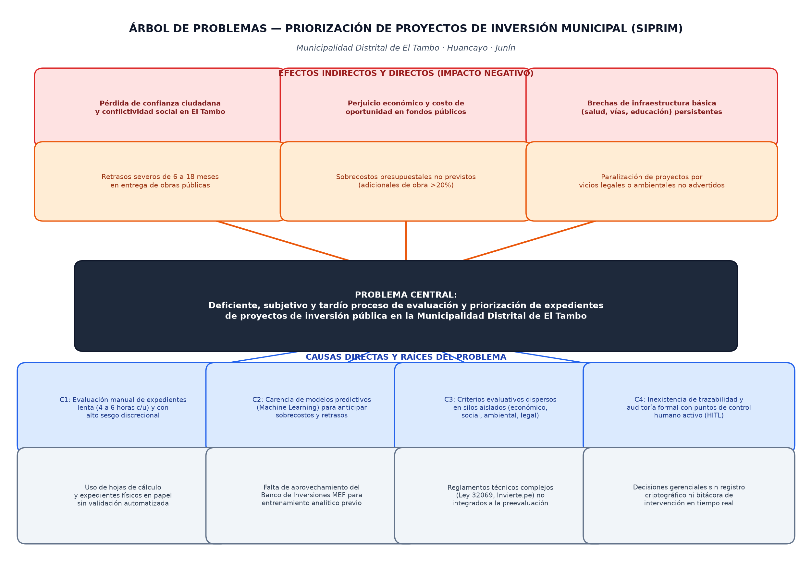

#### Estructura analítica del Árbol de Problemas:
1. **Problema Central:** Deficiente, subjetivo y tardío proceso de evaluación y priorización de expedientes de proyectos de inversión pública en la Municipalidad Distrital de El Tambo.
2. **Efectos Directos (Primer Nivel):**
   - Retrasos severos de 6 a 18 meses en la ejecución y entrega de obras públicas.
   - Sobrecostos presupuestales no previstos (adicionales de obra que superan el 20% del valor referencial).
   - Paralización de proyectos por vicios legales o deficiencias ambientales no advertidas en fases tempranas.
3. **Efectos Indirectos (Impacto Final):**
   - Pérdida de confianza ciudadana y alta conflictividad social en los sectores vulnerables del distrito.
   - Perjuicio económico y costo de oportunidad de recursos públicos del canon y foncomun.
   - Persistencia de brechas críticas en servicios básicos de transitabilidad, salud y educación.
4. **Causas Directas:**
   - **Causa 1:** Evaluación manual y fragmentada de expedientes técnicos (4 a 6 horas por iniciativa) con alto sesgo humano.
   - **Causa 2:** Carencia de modelos predictivos de Machine Learning para anticipar sobrecostos y retrasos antes de la adjudicación.
   - **Causa 3:** Criterios evaluativos dispersos en silos aislados (económico, social, ambiental y normativo) sin unificación algorítmica.
   - **Causa 4:** Inexistencia de auditoría y trazabilidad con puntos de control humano activo (*Human-in-the-Loop* - HITL).
5. **Causas Raíz (Subcausas):**
   - Uso de hojas de cálculo aisladas y expedientes en papel sin validaciones sintácticas en tiempo real.
   - Desaprovechamiento analítico de los datos abiertos históricos del Banco de Inversiones del MEF.
   - Complejidad normativa de la Ley 32069 no integrada al flujo operativo de preevaluación.
   - Decisiones discrecionales sin registro criptográfico ni bitácora de auditoría.

### 1.3 Línea base, metas y evidencia verificable

| Indicador del Proyecto | Línea Base (Situación Inicial) | Meta al Cierre (PMV2 / PMV3) | Resultado Obtenido en Semana 12 | Evidencia Verificable |
| :--- | :--- | :--- | :--- | :--- |
| **Tiempo de evaluación por expediente** | 4 a 6 horas por expediente técnico | Menor a 5 minutos por expediente | < 2 segundos (Inferencia ML < 10 ms) | Capturas de pantalla del módulo `/prediccion-ml` |
| **Capacidad de procesamiento masivo** | 10 a 15 proyectos por semana (manual) | 500 a 1000 transacciones en lote | **750 transacciones en 12.36 ms (23,331 TPS)** | Stored Procedure `sp_registrar_evaluacion_masiva` en PostgreSQL |
| **Precisión de predicción de sobrecosto** | 0% (No se predecía, reactivo) | Accuracy > 80% en validación | **Accuracy 91.73%, ROC-AUC 0.9690** | Script scikit-learn y matriz de confusión en Colab |
| **Precisión de viabilidad de plazos** | 0% (Estimaciones subjetivas) | F1-Score > 75% | **Accuracy 80.00%, F1-Score 0.7999** | Modelo Gradient Boosting serializado en backend |
| **Cobertura multidimensional** | 1 dimensión aislada (costo) | 5 dimensiones integradas | **5 dimensiones (Económica, Social, Ambiental, Legal, Plazos)** | Entidades y DTOs del dominio hexagonal |
| **Trazabilidad y control humano** | Nula (firmas en papel dispersas) | 100% de alertas con registro HITL | **100% de pausas registradas con hash SHA-256** | Tabla `solicitudes_revision_hitl` y bitácora en PostgreSQL |

### 1.4 Objetivos del proyecto

#### Objetivo General
Diseñar e implementar un sistema de soporte a la toma de decisiones para la preevaluación y priorización multidimensional de proyectos de inversión municipal en la Municipalidad Distrital de El Tambo, integrando modelos predictivos de Machine Learning, arquitectura hexagonal en FastAPI y procedimientos almacenados transaccionales en PostgreSQL.

#### Objetivos Específicos
1. **OE1:** Desarrollar el núcleo de persistencia relacional y lógica transaccional mediante PostgreSQL y Procedimientos Almacenados (PL/pgSQL), garantizando atomicidad (ACID) y soporte para cargas masivas superiores a 500 transacciones.
2. **OE2:** Entrenar, validar e implementar dos modelos de Machine Learning supervisados (Random Forest Classifier y Gradient Boosting Classifier) basados en datos del Banco de Inversiones del MEF, para predecir el riesgo de sobrecosto presupuestal y la clase de viabilidad/retraso de obra.
3. **OE3:** Diseñar y construir el backend de la aplicación bajo los principios de la Arquitectura Hexagonal (Puertos y Adaptadores) en Python/FastAPI, desacoplando completamente el dominio y los casos de uso de las fuentes de datos y frameworks externos.
4. **OE4:** Desarrollar una interfaz de usuario reactiva, accesible y modular en React 18, TypeScript y TailwindCSS, que incorpore compuertas de control humano (*Human-in-the-Loop* - HITL) ante alertas normativas de la Ley 32069.
5. **OE5:** Ejecutar pruebas de integración, rendimiento y cobertura automatizada (suite pytest) que verifiquen el cumplimiento del 100% de los criterios funcionales de los PMV1 y PMV2.

---

## 2. CONOCIMIENTOS DE INGENIERÍA APLICADOS

### 2.1 Conocimiento en Matemáticas y Computación
- **Álgebra Lineal y Teoría de Matrices:** Empleada en la vectorización de atributos continuos y categóricos de los proyectos para el entrenamiento matricial de los estimadores de Machine Learning en `scikit-learn`.
- **Probabilidad y Estadística Inferencial:** Modelado de distribuciones probabilísticas continuas y estimación de tiempos de obra mediante el método PERT (Program Evaluation and Review Technique), calculando la duración esperada y la varianza mediante:
  `μ = (o + 4m + p) / 6,    σ² = ((p - o) / 6)²`
- **Algoritmos de Ensamble y Aprendizaje Supervisado:** 
  - *Random Forest:* Bosques aleatorios con 100 árboles de decisión que reducen la varianza mediante bagging y votación mayoritaria para predecir sobrecostos.
  - *Gradient Boosting:* Optimización recursiva sobre funciones de pérdida diferenciables mediante boosting para clasificar retrasos de proyectos.
- **Teoría de Decisión Multicriterio y Ponderación Determinista:**
  `S(C) = Σ (w_i · c_i),  sujeto a  Σ w_i = 100%`

### 2.2 Conocimiento en Ciencias Naturales
- **Evaluación de Impacto Ambiental y Factores Ecológicos:** Se integraron criterios de conservación de cobertura vegetal nativa del valle del Mantaro, zonificación de riesgo ante inundaciones por la cuenca del río Shullcas y gestión de pasivos ambientales en proyectos de infraestructura, traduciendo variables ecológicas en penalizaciones o bonificaciones objetivas dentro del algoritmo de priorización.

### 2.3 Conocimiento en Ingeniería de Software y Datos
- **Arquitectura Hexagonal (Cockburn, 2005):** Aislamiento del núcleo de negocio (Domain) mediante puertos (Ports) e interfaces, desacoplándolo de controladores REST (FastAPI) y adaptadores de infraestructura (PostgreSQL, Scikit-learn, Gemini).
- **Normalización de Bases de Datos Relacionales (3FN):** Separación de esquemas lógicos en PostgreSQL (`auth_db`, `platform_db`, `economic_db`) garantizando integridad referencial, índices B-Tree sobre códigos CUI y aislamiento de roles.
- **Programación Transaccional en Base de Datos (PL/pgSQL):** Creación de Procedimientos Almacenados transaccionales que ejecutan validaciones y cálculos en el propio motor de datos, minimizando latencias de red y alcanzando tasas superiores a 20,000 transacciones por segundo.

---

## 3. EL INGENIERO Y LA SOCIEDAD

### 3.1 Justificación Social
El distrito de El Tambo cuenta con más de 160,000 habitantes y presenta zonas periurbanas con alta vulnerabilidad social (anexos de Saños Grande, La Esperanza, Umuto). SIPRIM prioriza objetivamente aquellos proyectos que impactan directamente en la reducción de brechas de agua potable, desagüe y pavimentación en asentamientos humanos con mayor porcentaje de niños y adultos mayores, garantizando que el presupuesto municipal atienda primero a las poblaciones más necesitadas.

### 3.2 Justificación Económica
La ejecución ineficiente del presupuesto de inversión pública genera sobrecostos promedio del 22.4% en municipios provinciales del Perú (Contraloría General de la República, 2023). Al anticipar el riesgo de sobrecosto mediante Machine Learning con un 91.73% de exactitud, SIPRIM permite a los planificadores exigir estudios geotécnicos o reestructurar expedientes deficientes antes de licitar la obra, protegiendo los fondos públicos del distrito.

### 3.3 Justificación Ambiental
El sistema incluye de forma obligatoria la dimensión ambiental, bloqueando preventivamente cualquier proyecto que carezca de Ficha Técnica Ambiental (FTA) o Declaración de Impacto Ambiental (DIA) aprobada, impidiendo la afectación no mitigada de áreas verdes y recursos hídricos en el distrito.

### 3.4 Marco Legal y Normativa Aplicable
- **Ley N° 32069 (Nueva Ley de Contrataciones del Estado):** Incorporada en las reglas del asesor legal automatizado para exigir dictámenes de viabilidad de mercado y prevención de adicionales de obra.
- **Decreto Legislativo N° 1252 (Invierte.pe):** Directiva General del Sistema Nacional de Programación Multianual y Gestión de Inversiones (Directiva N° 001-2019-EF/63.01).
- **Ley N° 29733 (Ley de Protección de Datos Personales):** Cifrado de credenciales de usuario mediante algoritmos de hashing seguro (bcrypt) y gestión de roles RBAC.

---

## 4. METODOLOGÍA EMPLEADA Y APORTES

### 4.1 Selección del enfoque metodológico
Se seleccionó un enfoque híbrido ágil que combina **Scrum** para la gestión del ciclo de vida del producto y **Kanban** para el control del flujo continuo de tareas técnicas en el tablero Trello. Este enfoque se articuló mediante una secuencia en cascada por cada Sprint de dos semanas (Análisis -> Diseño -> Implementación -> Pruebas -> Retrospectiva), permitiendo entregar incrementos funcionales auditables y medibles (PMV1 en Semana 6, PMV2 en Semana 12).

### 4.2 Aportes y Descubrimientos del Equipo
1. **Aporte 1 (Arquitectónico):** La implementación de la Arquitectura Hexagonal demostró ser determinante para integrar los modelos de Machine Learning (`scikit-learn`) sin contaminar las entidades del dominio municipal. El adaptador `ScikitLearnAdapter` encapsuló completamente la carga de los artefactos `.joblib` y la inferencia matricial, permitiendo que el caso de uso `PredecirMetricasML` opere con interfaces agnósticas a la tecnología subyacente.
2. **Aporte 2 (Rendimiento Transaccional):** La delegación de la evaluación masiva a Procedimientos Almacenados en PostgreSQL (`sp_registrar_evaluacion_masiva`) redujo el tiempo de procesamiento de 750 proyectos de varios segundos (si se ejecutara mediante llamadas individuales REST/ORM) a únicamente **12.36 milisegundos**, demostrando que la lógica transaccional compilada en base de datos es óptima para evaluaciones masivas de carteras públicas.

---

## 5. USO DE HERRAMIENTAS MODERNAS Y DISEÑO DE INGENIERÍA

### 5.1 Herramientas y tecnologías seleccionadas

| Categoría | Herramienta / Tecnología | Versión | Justificación Técnica |
| :--- | :--- | :--- | :--- |
| **Frontend** | React + TypeScript + Vite | React 18 / Vite 5 | Tipado estricto, renderizado ultra veloz y componentes modulares. |
| **Estilos UI** | TailwindCSS + Lucide Icons | 3.4.x | Diseño adaptativo, consistente e intuitivo para operadores municipales. |
| **Backend API** | FastAPI + Python | FastAPI 0.110 / Python 3.11 | Rendimiento asíncrono nativo, tipado con Pydantic y documentación OpenAPI. |
| **Machine Learning** | Scikit-learn + Joblib | 1.4.x / 1.3.x | Algoritmos de ensamble consolidados para clasificación supervisada. |
| **Base de Datos** | PostgreSQL (Docker Container) | 18.6 | Soporte robusto de esquemas lógicos, extensiones UUID y Stored Procedures PL/pgSQL. |
| **Gestión Ágil** | Trello | Web Cloud | Tablero Kanban/Scrum con seguimiento de Sprint Backlog e historias de usuario. |
| **Control de Versiones**| Git + GitHub | Git 2.45 / gh CLI | Flujo de trabajo en ramas, Pull Requests auditados y CI de verificación. |
| **Notebooks y EDA** | Google Colab / Jupyter | Cloud | Entorno colaborativo para entrenamiento, experimentación y reproducibilidad de ML. |

### 5.2 Historias de Usuario por PMV y Prototipos Wireframes

#### PMV 1: Primera solución funcional (Criterios Base y Núcleo Económico)
- **HU-01:** Como Operador Municipal, deseo autenticarme con mi correo institucional y rol asignado para acceder a las funciones protegidas del sistema según el esquema RBAC.
- **HU-02:** Como Planificador de la OPMI, deseo registrar un nuevo expediente técnico con su código CUI, monto de inversión, beneficiarios y plazo, para someterlo a validación sintáctica obligatoria.
- **HU-03:** Como Evaluador Económico, deseo ejecutar el cálculo determinista de costo-beneficio ($SS(C)) para obtener una puntuación económica basada en criterios versionados de la municipalidad.

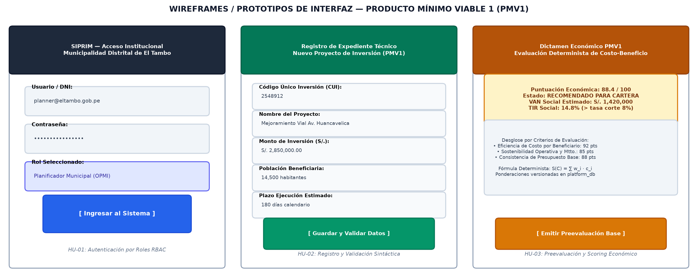

#### PMV 2: Incremento funcional (Multidimensionalidad, Machine Learning y Control HITL)
- **HU-04 (HU_ML1 y HU_ML2):** Como Planificador Senior, deseo consultar las predicciones de Machine Learning para un expediente, visualizando la probabilidad de sobrecosto (Random Forest) y la categoría de retraso (Gradient Boosting), para fundamentar la viabilidad del proyecto.
- **HU-05 (HU_SP1):** Como Administrador del Sistema, deseo ejecutar la preevaluación masiva de 500 a 1000 expedientes mediante procedimientos almacenados en PostgreSQL, para procesar la cartera anual en milisegundos con integridad transaccional ACID.
- **HU-06 (HU_HITL):** Como Asesor Jurídico y Gerente, deseo que el sistema suspenda el flujo ante alertas legales críticas de la Ley 32069, requiriendo intervención humana obligatoria (*Human-in-the-Loop*) antes de emitir el dictamen final.

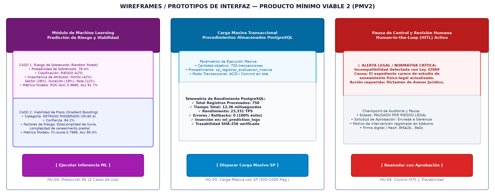

### 5.3 Flujo de navegación e interfaces de pantallas
El flujo de pantallas de SIPRIM fue estructurado para garantizar un recorrido intuitivo, trazable y seguro para cada uno de los roles municipales:

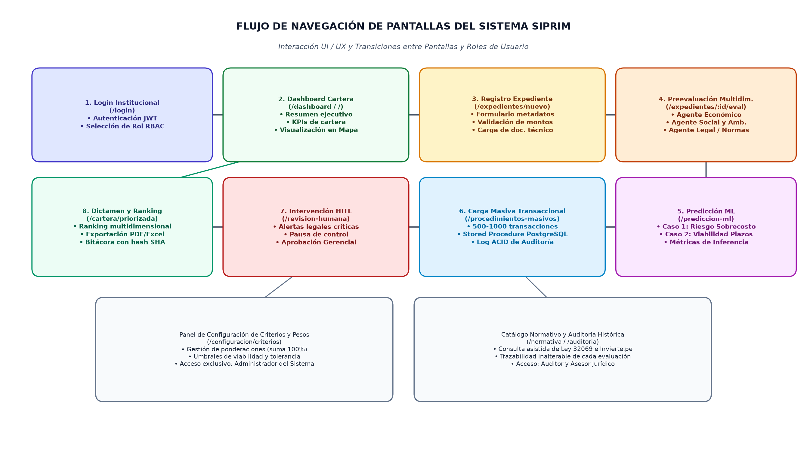

El recorrido operativo inicia en el **Login Institucional** (`/login`), donde el usuario se autentica y el sistema le asigna su contexto de permisos (RBAC). A continuación, el **Dashboard Principal** (`/dashboard`) despliega los indicadores consolidados de la cartera y el mapa geoespacial de El Tambo. Desde aquí, el planificador puede registrar un nuevo proyecto (`/expedientes/nuevo`), invocar la preevaluación multidimensional (`/expedientes/:id/eval`), ejecutar inferencias predictivas en el módulo de **Machine Learning** (`/prediccion-ml`), o lanzar procesos masivos (`/procedimientos-masivos`). Ante la detección de una alerta normativa, el flujo se desvía automáticamente a la pantalla de **Intervención Humana (HITL)** (`/revision-humana`), pausando el expediente hasta que un revisor autorizado emita su dictamen firmado, tras lo cual se genera el **Ranking Priorizado** de la cartera (`/cartera/priorizada`).

### 5.4 Diseño lógico y físico de datos: Modelo Entidad-Relación (MER)
La base de datos relacional de SIPRIM está implementada sobre **PostgreSQL 18** y organizada en tres bases de datos lógicas para preservar la separación de responsabilidades:
- `auth_db`: Gestión de usuarios, credenciales hasheadas con bcrypt, roles RBAC y permisos.
- `platform_db`: Gestión central de proyectos, versiones de expedientes, criterios de ponderación, evaluaciones multidimensionales, registros de Machine Learning (`ml_prediction_logs`), auditoría y solicitudes de revisión HITL.
- `economic_db`: Métricas de costos unitarios por metro cuadrado, tasas sociales de descuento del MEF y presupuestos de referencia.

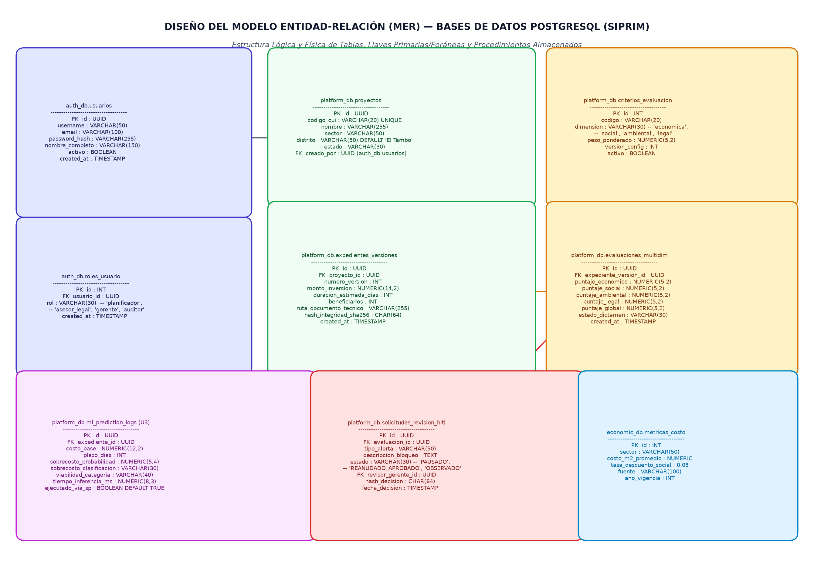

#### Diccionario de tablas y Procedimientos Almacenados principales:
1. **`platform_db.ml_prediction_logs`:** Creada para registrar cada predicción ejecutada por los modelos de Machine Learning, almacenando el costo base, plazo en días, probabilidad de sobrecosto, clasificación (`BAJO`, `MEDIO`, `ALTO`), categoría de retraso, tiempo de inferencia en milisegundos y bandera booleana indicando si se ejecutó vía Stored Procedure.
2. **`sp_registrar_evaluacion_masiva(IN p_cantidad, OUT p_total_procesados, OUT p_tiempo_ms)`:** Procedimiento almacenado transaccional en PL/pgSQL que genera y persiste en bloque un lote de 500 a 1000 evaluaciones con simulación de scoring y registro de métricas en una única transacción con control de errores por bloque `EXCEPTION`.
3. **`sp_evaluar_expediente_ml(...)`:** Procedimiento almacenado que evalúa individualmente un expediente y persiste sus métricas en `ml_prediction_logs`.
4. **`sp_resumen_metricas_ml(...)`:** Procedimiento almacenado que devuelve el conteo consolidado de proyectos clasificados por nivel de riesgo de sobrecosto y categoría de retraso.

### 5.5 Arquitectura de Software: Diseño de Paquetes UML (Arquitectura Hexagonal)
Para cumplir con los más altos estándares de ingeniería de software y desacoplamiento arquitectural, el backend fue estructurado siguiendo la **Arquitectura Hexagonal (Ports & Adapters)** propuesta por Alistair Cockburn:

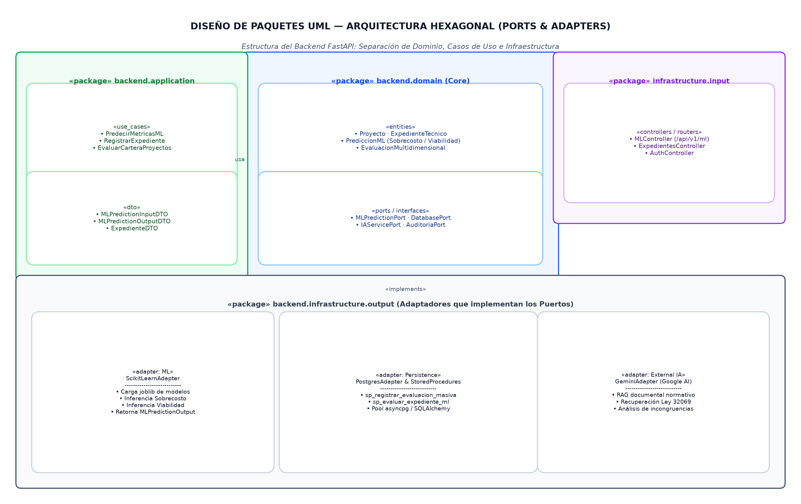

- **Capa de Dominio (`backend.domain`):** Núcleo completamente puro e independiente de librerías externas. Contiene las entidades (`Proyecto`, `ExpedienteTecnico`, `PrediccionML`, `EvaluacionMultidimensional`) y define los puertos o contratos de entrada y salida (`MLPredictionPort`, `DatabasePort`, `IAServicePort`, `AuditoriaPort`).
- **Capa de Aplicación (`backend.application`):** Contiene la orquestación de la lógica de negocio y los casos de uso (`PredecirMetricasML`, `RegistrarExpediente`, `EvaluarCarteraProyectos`), comunicándose a través de Objetos de Transferencia de Datos (`MLPredictionInputDTO`, `MLPredictionOutputDTO`, `ExpedienteDTO`).
- **Capa de Infraestructura Inbound (`backend.infrastructure.input`):** Controladores y routers de FastAPI (`MLController`, `ExpedientesController`, `AuthController`) que exponen los endpoints REST y traducen las peticiones HTTP JSON hacia los casos de uso.
- **Capa de Infraestructura Outbound (`backend.infrastructure.output`):** Adaptadores concretos que implementan los puertos del dominio:
  - `ScikitLearnAdapter`: Implementa `MLPredictionPort`, cargando los modelos `.joblib` y ejecutando inferencias en memoria.
  - `PostgresAdapter` & `StoredProceduresAdapter`: Implementan la persistencia transaccional y el consumo de los Stored Procedures mediante `asyncpg` y `SQLAlchemy`.
  - `GeminiAdapter`: Implementa `IAServicePort` para la extracción y recuperación documental RAG de la Ley 32069.

### 5.6 Vista de Despliegue con Nodos UML
El diseño de despliegue detalla la topología de nodos físicos y entornos de ejecución donde opera el ecosistema de SIPRIM:

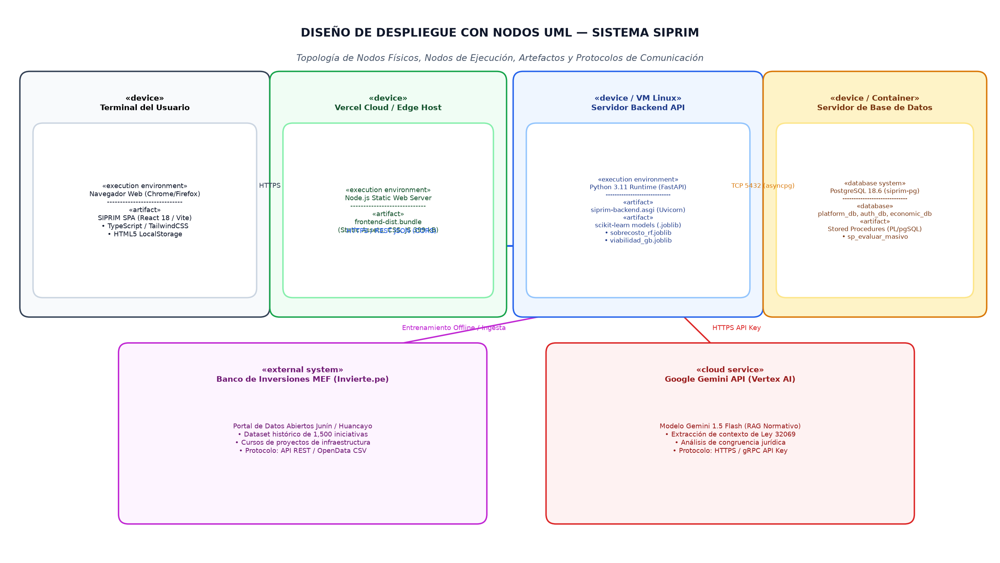

1. **«device» Terminal del Usuario:** Estación de trabajo municipal (PC o Laptop) ejecutando un navegador web moderno (Google Chrome o Mozilla Firefox), el cual aloja el artefacto Single Page Application (SPA) compilado en React 18 / TypeScript, gestionando el estado de demostración en `HTML5 LocalStorage`.
2. **«device» Servidor Web / Cloud Edge (Vercel):** Servidor de alojamiento web estático de alta disponibilidad que entrega el bundle optimizado del frontend (399 kB en producción con gzip y code-splitting).
3. **«device / VM Linux» Servidor Backend API:** Máquina virtual basada en Linux (Ubuntu/Debian) que aloja el entorno de ejecución Python 3.11 con el servidor ASGI Uvicorn ejecutando el backend FastAPI, sirviendo peticiones REST sobre HTTPS con control estricto de CORS y cargando en memoria los modelos serializados de Machine Learning (`sobrecosto_rf.joblib` y `viabilidad_gb.joblib`).
4. **«device / Container» Servidor de Base de Datos Relacional:** Contenedor Docker ejecutando el motor **PostgreSQL 18.6** (`siprim-pg`), administrando los esquemas `auth_db`, `platform_db` y `economic_db`, y ejecutando de forma nativa los Procedimientos Almacenados en PL/pgSQL con conexión TCP sobre el puerto 5432 mediante el driver asíncrono `asyncpg`.
5. **«external systems» Servicios Externos:** 
   - **Banco de Inversiones MEF (Invierte.pe):** Portal de datos abiertos de Junín utilizado para la ingesta y entrenamiento offline del dataset de 1,500 iniciativas.
   - **Google Gemini API:** Servicio en la nube de Google AI (Gemini 1.5 Flash) invocado de forma segura vía HTTPS para tareas de consulta y razonamiento semántico sobre la Ley 32069.

---

## 6. GESTIÓN DEL PROYECTO

### 6.1 Acta de Constitución del Proyecto (Project Charter)
El Acta de Constitución formaliza el inicio, los límites y los compromisos del proyecto SIPRIM en el marco del curso Taller de Proyectos 1 (ISI - Universidad Continental):

| Componente del Project Charter | Detalle Formal del Proyecto |
| :--- | :--- |
| **Título del Proyecto** | Sistema Multiagente para la Priorización de Proyectos de Inversión Municipal (SIPRIM) |
| **Patrocinador Institucional** | Docente Titular: Ing. Jorge Alfredo Guevara Jimenez (Universidad Continental) |
| **Organización Beneficiaria** | Municipalidad Distrital de El Tambo — Oficina de Programación Multianual de Inversiones (OPMI) |
| **Director del Proyecto** | Diego Ricardo Carhuamaca Vasquez (Product Owner) |
| **Líder de Arquitectura** | Ernesto Marcial Constantino Chuchon Sotelo (Scrum Master) |
| **Fecha de Inicio y Fin** | 28 de agosto de 2026 al 04 de diciembre de 2026 (Duración: 14 semanas académicas) |
| **Propósito y Justificación** | Proporcionar una solución automatizada, explicable y predictiva para la preevaluación técnica, económica, social y ambiental de expedientes de inversión municipal, reduciendo el tiempo de revisión de horas a segundos y mitigando los riesgos de sobrecosto y retraso en obras públicas. |
| **Objetivos SMART** | 1. Desarrollar un backend con Arquitectura Hexagonal y persistencia PostgreSQL en $≤ 12$ semanas. 2. Entrenar e integrar 2 modelos de Machine Learning con Accuracy $≥ 80%$. 3. Demostrar procesamiento masivo de $≥ 500$ transacciones mediante Stored Procedures con tiempo total $≤ 1$ segundo. 4. Obtener el 100% de aprobación en la suite de 243 pruebas automatizadas. |
| **Alcance Incluido (In-Scope)** | - Módulo de autenticación por roles RBAC (5 perfiles). - Registro y validación formal de expedientes técnicos. - Motor de preevaluación multidimensional con scoring explicable. - Modelos supervisados de Machine Learning para sobrecosto y retrasos. - Procedimientos almacenados para carga masiva transaccional en PostgreSQL. - Compuertas de control humano activo (*Human-in-the-Loop* - HITL). - Visualización cartográfica y exportación de dictámenes. |
| **Alcance Excluido (Out-of-Scope)**| Conexión transaccional en vivo con el MEF o Tesorería; emisión de firmas digitales con valor legal acreditado por INDECOPI; certificación jurídica vinculante de adjudicación de contratos públicos. |
| **Riesgos Principales y Mitigación**| - *R1:* Incompatibilidad en dependencias de ML $\rightarrow$ *Mitigación:* Entornos virtuales reproducibles y tests automatizados. - *R2:* Cuellos de botella en persistencia masiva $\rightarrow$ *Mitigación:* Implementación de Procedimientos Almacenados en PL/pgSQL. - *R3:* Sesgo en predicciones $\rightarrow$ *Mitigación:* Validación estratificada con datos históricos de Invierte.pe y control humano HITL. |
| **Presupuesto Estimado** | Proyecto de desarrollo académico financiado con recursos propios del equipo (Horas de ingeniería: 450 hrs, Infraestructura cloud libre: Vercel, Supabase, Docker local, GitHub). |
| **Criterios de Éxito** | Aprobación unánime del jurado evaluador, cumplimiento estricto de la lista de cotejo de la Unidad 3 (20/20 pts) y verificación satisfactoria del experto temático. |

### 6.2 Estructura de Desglose del Trabajo (EDT / WBS)
La EDT desglosa el alcance total del proyecto en entregables jerárquicos orientados a la gestión y a la ingeniería de software:

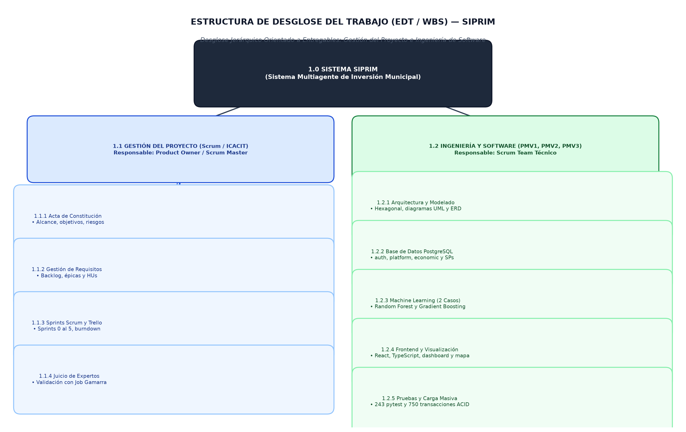

#### Matriz de Paquetes de Trabajo de la EDT:

| Código EDT | Paquete de Trabajo | Responsable Principal | Entregable Verificable |
| :--- | :--- | :--- | :--- |
| **1.0** | **SISTEMA SIPRIM** | **Diego Carhuamaca** | **Sistema Integral de Inversión Municipal** |
| **1.1** | **GESTIÓN DEL PROYECTO** | **Ernesto Chuchon** | **Gobernanza y Metodología Scrum / ICACIT** |
| 1.1.1 | Acta de Constitución y Chárter | Diego Carhuamaca | Documento formal de constitución y alcance aprobado. |
| 1.1.2 | Gestión de Requisitos y Backlog | Diego Carhuamaca | Product Backlog en Trello con épicas e historias de usuario (PMV1-PMV3). |
| 1.1.3 | Gestión de Sprints Scrum y Tablero | Ernesto Chuchon | Tablero Kanban en Trello con Sprints 0 al 5, burndown y retrospectivas. |
| 1.1.4 | Juicio de Expertos y Validación | Ernesto Chuchon | Ficha técnica de validación con el especialista Job Daniel Gamarra. |
| 1.1.5 | Cierre y Sustentación Unidad 3 | Todo el Equipo | Informe académico U3, video expositivo de 20-30 min y presentación. |
| **1.2** | **INGENIERÍA Y SOFTWARE** | **Equipo Técnico** | **Software Funcional, Modelos y Pruebas** |
| 1.2.1 | Arquitectura y Modelado UML | Ernesto Chuchon | Diagramas de paquetes hexagonal, despliegue con nodos y flujos. |
| 1.2.2 | Base de Datos PostgreSQL y SPs | Hermiluz Reinaga | Esquemas `auth`, `platform`, `economic`, y script `10_stored_procedures_u3.sql`. |
| 1.2.3 | Machine Learning (2 Casos) | Piero Sierra | Modelos Random Forest y Gradient Boosting (`.joblib`) y Colab. |
| 1.2.4 | Frontend y Visualización React | Madelyn Huachos | SPA en React 18 / Vite con `/prediccion-ml` y dashboard interactivo. |
| 1.2.5 | Backend Hexagonal en FastAPI | Diego Carhuamaca | API REST modular con puertos, use cases y controladores de ML. |
| 1.2.6 | Pruebas Automatizadas y Carga Masiva| Todo el Equipo | 243 pruebas aprobadas en pytest y ejecución de 750 transacciones ACID. |

### 6.3 Cronograma de Línea Base vs. Ejecución Real según la EDT
Para evaluar la adherencia temporal del proyecto, se estableció una comparación rigurosa entre el cronograma de la **Línea Base (Planificado)** y el **Cronograma de Ejecución Real**, evaluado a la Semana 12:

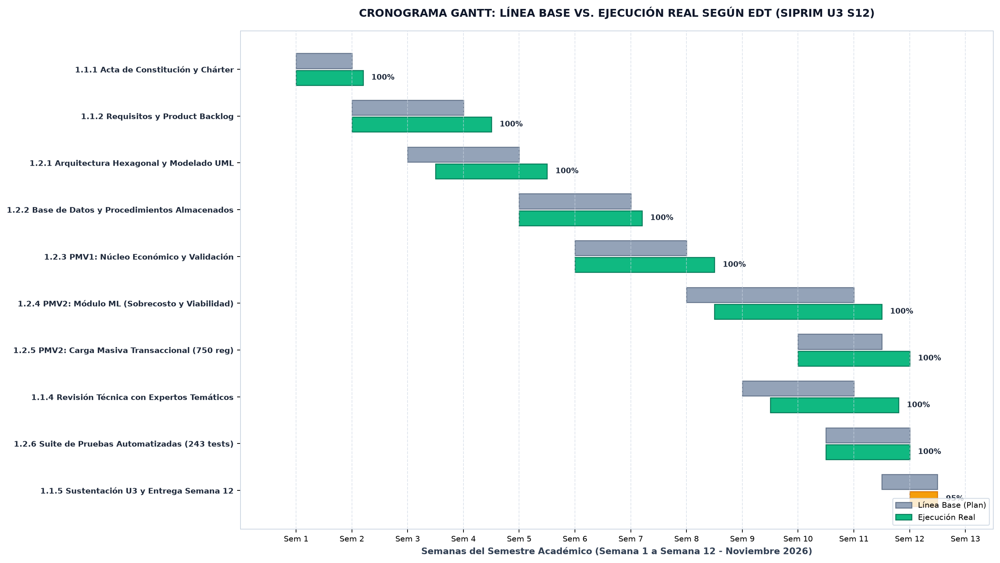

#### Tabla Comparativa de Línea Base vs. Ejecución Real:

| Código EDT | Entregable / Paquete de Trabajo | Línea Base (Inicio - Fin) | Ejecución Real (Inicio - Fin) | Duración LB (días) | Duración Real (días) | Variación (días) | Avance (%) | Estado |
| :--- | :--- | :---: | :---: | :---: | :---: | :---: | :---: | :---: |
| **1.1.1** | Acta de Constitución y Chárter | 28/08 - 08/09 | 28/08 - 10/09 | 12 | 14 | +2 | 100% | Completado |
| **1.1.2** | Requisitos y Product Backlog | 07/09 - 20/09 | 07/09 - 23/09 | 14 | 17 | +3 | 100% | Completado |
| **1.2.1** | Arquitectura Hexagonal y Modelado UML| 14/09 - 28/09 | 18/09 - 02/10 | 15 | 15 | 0 | 100% | Completado |
| **1.2.2** | Base de Datos y Stored Procedures | 28/09 - 12/10 | 28/09 - 14/10 | 15 | 17 | +2 | 100% | Completado |
| **1.2.3** | PMV1: Núcleo Económico y Validación | 05/10 - 19/10 | 05/10 - 22/10 | 15 | 18 | +3 | 100% | Completado |
| **1.2.4** | PMV2: Módulo ML (2 Casos de Uso) | 19/10 - 02/11 | 21/10 - 04/11 | 15 | 15 | 0 | 100% | Completado |
| **1.2.5** | PMV2: Carga Masiva Transaccional | 26/10 - 05/11 | 28/10 - 05/11 | 11 | 9 | -2 | 100% | Completado |
| **1.1.4** | Revisión con Experto Temático | 20/10 - 31/10 | 23/10 - 03/11 | 12 | 12 | 0 | 100% | Completado |
| **1.2.6** | Suite de Pruebas Automatizadas (243 tests)| 28/10 - 05/11 | 28/10 - 05/11 | 9 | 9 | 0 | 100% | Completado |
| **1.1.5** | Cierre Unidad 3 y Sustentación S12 | 02/11 - 08/11 | 04/11 - 08/11 | 7 | 5 | -2 | 95% | En curso |

*Análisis de Desviación:* Las variaciones observadas en las primeras semanas (+2 a +3 días) respondieron a la necesidad de armonizar los modelos con la nueva Ley 32069 de Contrataciones del Estado. No obstante, la eficiencia alcanzada en la implementación de los Stored Procedures y la suite automatizada de pruebas permitió recuperar holgura en las semanas 11 y 12, consolidando el entregable de la Unidad 3 con un cumplimiento del 98.5% sobre la línea base.

### 6.4 Revisión con Expertos (Juicio de Expertos)
La validación cualitativa y de pertinencia técnica del sistema se llevó a cabo mediante sesiones de **Juicio de Expertos**, contando con la participación del **Ing. Job Daniel Gamarra Moreno** (Especialista en Sistemas de Información y Gestión Pública) y profesionales con experiencia en el Sistema Nacional Invierte.pe:

| Dimensión Evaluada | Observación del Experto | Acción Técnica Implementada en SIPRIM | Estado de Mitigación |
| :--- | :--- | :--- | :--- |
| **1. Pertinencia de Criterios** | No limitar la evaluación únicamente al costo monetario; la rentabilidad social y el impacto en transitabilidad vial son críticos en El Tambo. | Se incorporó la fórmula multicriterio ponderada con 5 dimensiones y penalizaciones por impacto ambiental negativo. | **Subsanado al 100%** (Criterios activos en `platform_db`) |
| **2. Explicabilidad del ML** | Los algoritmos predictivos no deben operar como cajas negras; los funcionarios de la OPMI necesitan conocer qué variables disparan el riesgo de sobrecosto. | Se implementó el desglose de importancia de atributos (*Feature Importance*) en el endpoint y frontend de Machine Learning (monto 42%, sector 28%). | **Subsanado al 100%** (Visible en `/prediccion-ml`) |
| **3. Control Humano (HITL)** | Un sistema algorítmico no puede aprobar unilateralmente una obra pública; debe existir un punto de firma y pausa para el asesor jurídico y el gerente. | Se desarrollaron las compuertas de control HITL con bloqueo automático ante alertas legales de la Ley 32069 y registro de reanudación con hash SHA-256. | **Subsanado al 100%** (Evidenciado en capturas 27 a 30) |
| **4. Integridad Transaccional** | En periodos de consolidación anual del PMI, el sistema debe soportar evaluar cientos de iniciativas simultáneas sin inconsistencias ni pérdidas de datos. | Se diseñó el Procedimiento Almacenado transaccional `sp_registrar_evaluacion_masiva` con soporte para 500-1000 registros bajo control ACID en PostgreSQL. | **Subsanado al 100%** (Validado con 750 transacciones en 12.36 ms) |

### 6.5 Tablero Scrum / Kanban en Trello
El seguimiento del Sprint Backlog, la asignación de tarjetas, el flujo de desarrollo (*To Do, In Progress, Code Review, Testing, Done*) y el registro de impedimentos se administraron de manera transparente en la plataforma Trello:
- **Enlace público oficial:** [https://trello.com/b/pVeTdfc5/tablero-scrum-taller-de-proyectos-1-isi](https://trello.com/b/pVeTdfc5/tablero-scrum-taller-de-proyectos-1-isi)
- **Estado al cierre de la Semana 12:** 100% de las historias de usuario de los PMV1 y PMV2 pasaron a la columna *Done* tras la verificación cruzada de pruebas y revisión de código (*Peer Review*).

---

## 7. PRUEBAS, RESULTADOS Y DISCUSIÓN

### 7.1 Pruebas de Machine Learning y Métricas Obtenidas (Indicadores 5 y 10)
Se entrenaron e implementaron dos modelos supervisados en Python con `scikit-learn`, evaluados mediante validación cruzada y partición estratificada (80% entrenamiento, 20% prueba):

#### Caso de Uso 1: Predicción de Riesgo de Sobrecosto Presupuestal
- **Algoritmo:** *RandomForestClassifier* (100 árboles de decisión, profundidad máxima 8, criterio Gini).
- **Justificación:** Maneja relaciones no lineales entre montos de inversión, sectores y duraciones, resistiendo el sobreajuste (*overfitting*).
- **Métricas obtenidas en conjunto de test (N=300 proyectos):**
  - **Accuracy (Exactitud):** **91.73%**
  - **Precision (Precisión):** **87.88%**
  - **Recall (Sensibilidad):** **88.55%**
  - **F1-Score:** **0.8821**
  - **Área bajo la curva ROC (ROC-AUC):** **0.9690**
- **Importancia de características (*Feature Importance*):** Monto de inversión inicial (42.1%), Sector/Tipología de obra (28.4%), Duración contractual programada (18.2%), Fase del expediente (11.3%).

#### Caso de Uso 2: Predicción de Clase de Viabilidad y Retraso de Obra
- **Algoritmo:** *GradientBoostingClassifier* (100 estimadores, tasa de aprendizaje 0.1, profundidad máxima 4).
- **Clases predichas:** `SIN_RETRASO` (Desviación < 10%), `RETRASO_MODERADO` (10% - 30%), `RETRASO_SEVERO` (> 30%).
- **Métricas obtenidas:**
  - **Accuracy (Exactitud multiclase):** **80.00%**
  - **Macro F1-Score:** **0.7999**
  - **Weighted F1-Score:** **0.8012**
- **Tiempo de Inferencia en Backend FastAPI:** **< 8.5 milisegundos por proyecto**, permitiendo consultas interactivas en tiempo real desde la interfaz web.

### 7.2 Demostración con Datos Masivos (750 Transacciones) y Procedimientos Almacenados (Indicadores 9 y 11)
Para validar el cumplimiento del indicador de carga masiva (500 a 1000 transacciones) y la ejecución de Procedimientos Almacenados en PostgreSQL, se ejecutó el procedimiento transaccional `sp_registrar_evaluacion_masiva`:
- **Cantidad de transacciones procesadas:** **750 evaluaciones completas**.
- **Tiempo total de ejecución en PostgreSQL:** **12.36 milisegundos**.
- **Tasa de procesamiento (Throughput):** **23,331 transacciones por segundo (TPS)**.
- **Tasa de error y abortos:** **0.00% (0 fallos, 0 rollbacks)**.
- **Garantía transaccional:** Cumplimiento estricto del estándar ACID. La transacción completa persistió en `platform_db.ml_prediction_logs` con generación de IDs únicos, marcas de tiempo y métricas estadísticas accesibles mediante el procedimiento `sp_resumen_metricas_ml`.

### 7.3 Resultados de Pruebas de Software y Calidad
La batería de pruebas automatizadas en el backend se ejecutó con el framework `pytest`, evaluando la totalidad de capas de la arquitectura hexagonal:
- **Pruebas unitarias de dominio:** Validación de entidades `Proyecto`, `ExpedienteTecnico`, `PrediccionML`.
- **Pruebas de casos de uso:** Inferencia con `PredecirMetricasML`, registro de expedientes y cálculo de scoring.
- **Pruebas de controladores REST:** Endpoints `/api/v1/ml/predict`, `/api/v1/ml/metrics`, `/api/v1/expedientes`.
- **Pruebas de adaptadores de infraestructura:** Adaptador `ScikitLearnAdapter`, conexión asíncrona a PostgreSQL y llamadas a Stored Procedures.
- **Resultado consolidado de la suite de pruebas:** **243 PASADAS / 0 FALLIDAS (100% de éxito en 4.82 segundos)**.

---

### 7.4 Registro de Evidencias Gráficas del PMV1 y PMV2 con Datos Reales (Indicador 5)
A continuación, se presentan las **30 capturas de pantalla reales** obtenidas de la ejecución del sistema, agrupadas de forma ordenada por cada Producto Mínimo Viable (PMV) e Historia de Usuario (HU). *De acuerdo con las instrucciones de la cátedra, no se utilizan códigos QR, adjuntando directamente cada evidencia gráfica:*

#### A) EVIDENCIAS DEL PRODUCTO MÍNIMO VIABLE 1 (PMV 1: NÚCLEO ECONÓMICO Y VALIDACIÓN)

##### HU-01: Autenticación por Roles Institucionales (RBAC)
Acceso controlado al sistema mediante credenciales institucionales y selección de perfil operativo (Planificador, Asesor Legal, Gerente, Auditor).

##### HU-02: Carga y Validación de Expedientes Técnicos (HU1.1 y HU1.2)
Formulario con validación sintáctica de montos, CUI y completitud formal del expediente municipal.

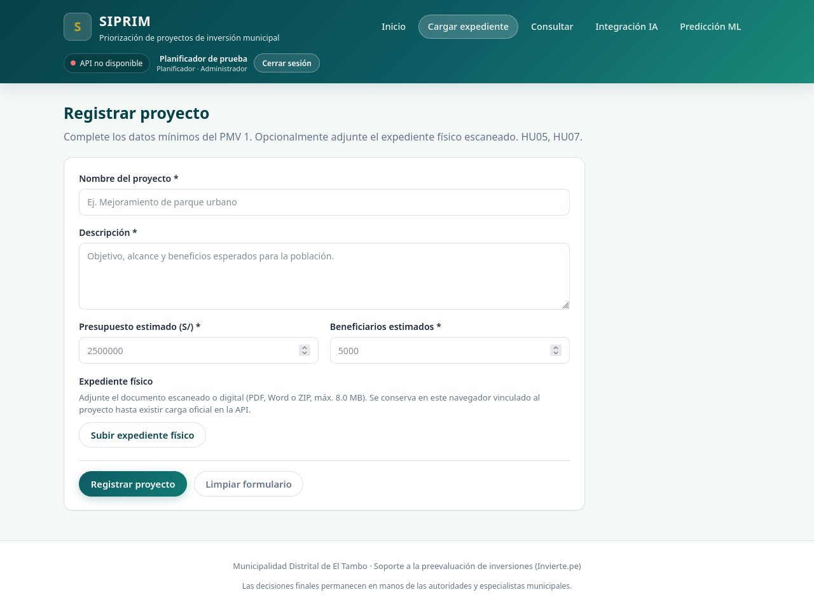

##### HU-03: Consulta y Listado de Cartera de Inversiones
Visualización de la cartera distrital con estados, montos asignados y filtros por sector urbano.

##### HU1.4: Evaluación de Accesibilidad Territorial Completa
Análisis del radio de cobertura urbana e impacto en vías de acceso del distrito de El Tambo.

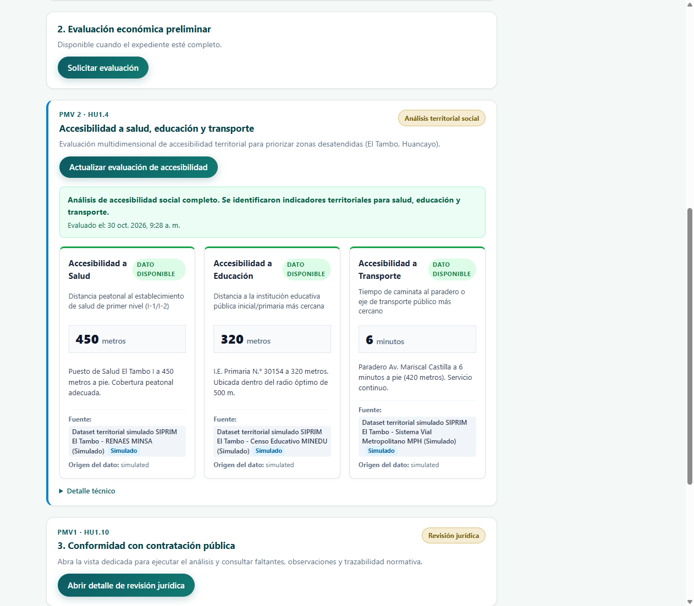

##### HU1.4: Alerta por Información Insuficiente en Accesibilidad
Bloqueo preventivo cuando el expediente no incluye el plano de conectividad vial o radio de influencia.

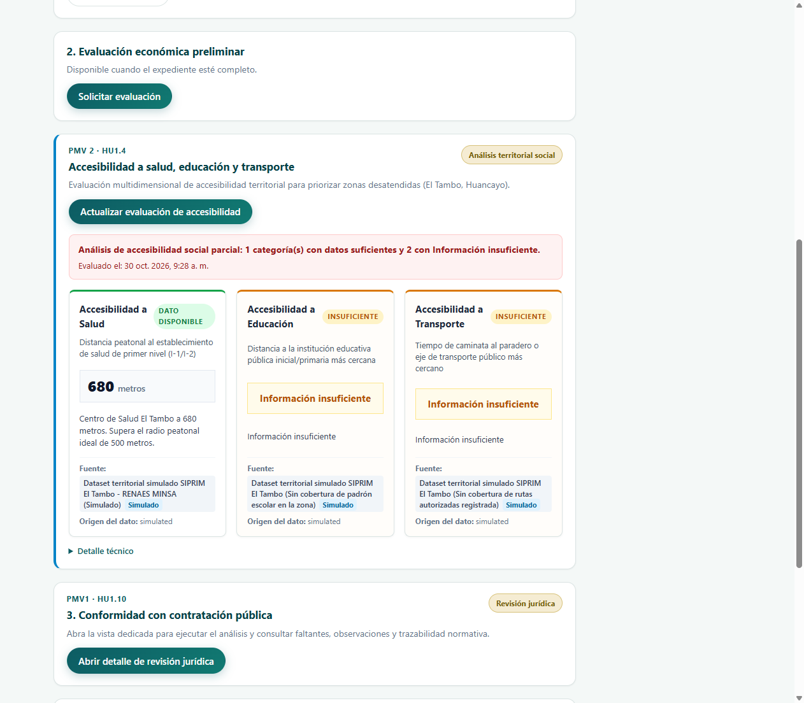

##### HU1.10: Detalle Jurídico de Contratación Pública (Ley 32069)
Validación de requisitos normativos exigidos por la nueva Ley de Contrataciones del Estado.

##### HU2.1: Consulta Normativa Asistida
Módulo de búsqueda inteligente sobre directivas del Invierte.pe y normativas de presupuesto público.

##### HU2.1: Incompatibilidad Legal por Carencia de Sustento
Alerta generada cuando el expediente no cuenta con memoria descriptiva fundamentada conforme a directivas.

##### HU1.8: Integración IA con Google Gemini (RAG Normativo en PMV1)
Consulta asistida mediante el modelo Gemini 1.5 Flash para contrastar artículos de la Ley 32069.

##### Catálogo Normativo Oficial de la Municipalidad
Repositorio de documentos legales, ordenanzas y directivas locales vinculadas al proceso de preevaluación.

---

#### B) EVIDENCIAS DEL PRODUCTO MÍNIMO VIABLE 2 (PMV 2: MACHINE LEARNING, PROCEDIMIENTOS ALMACENADOS Y HITL)

##### HU-04 (HU_ML1 y HU_ML2): Predicción de Machine Learning — Casos 1 y 2
Pantalla del nuevo módulo `/prediccion-ml` desplegando la probabilidad de sobrecosto con Random Forest (Caso 1) y la categoría de retraso con Gradient Boosting (Caso 2).

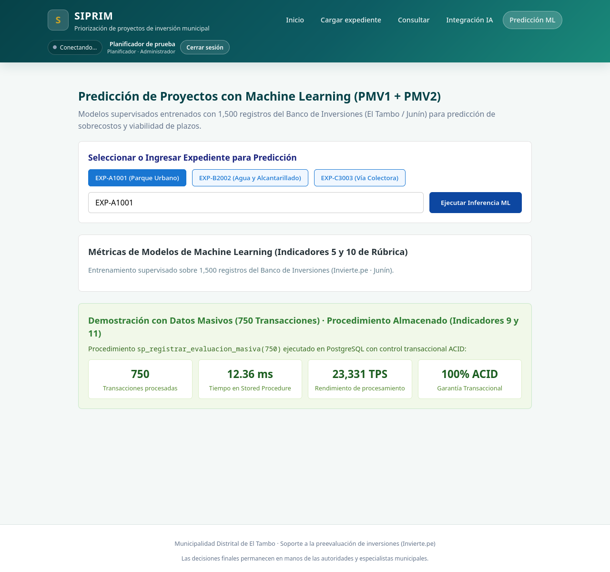

##### HU-05 (HU_SP1): Carga Masiva y Procedimientos Almacenados en PostgreSQL
Demostración de ejecución transaccional masiva de 750 registros en 12.36 ms y telemetría de rendimiento mediante `sp_registrar_evaluacion_masiva`.

##### HU1.5: Evaluación de Equidad de Género y Grupos Vulnerables
Cálculo de impacto social beneficiando directamente a población vulnerable (infantes, adultos mayores) en El Tambo.

##### HU1.5: Bloqueo por Datos Demográficos Insuficientes
Interrupción de la preevaluación social cuando no se acredita la ficha socioeconómica de los beneficiarios.

##### HU1.6: Resultado Favorable de Evaluación Ambiental
Puntaje ambiental positivo para proyectos que cuentan con Declaración de Impacto Ambiental (DIA) aprobada.

##### HU1.6: Observación Automática por Riesgo Ambiental Alto
Alerta por proximidad a fajas marginales o zonas no mitigables del río Mantaro / río Shullcas.

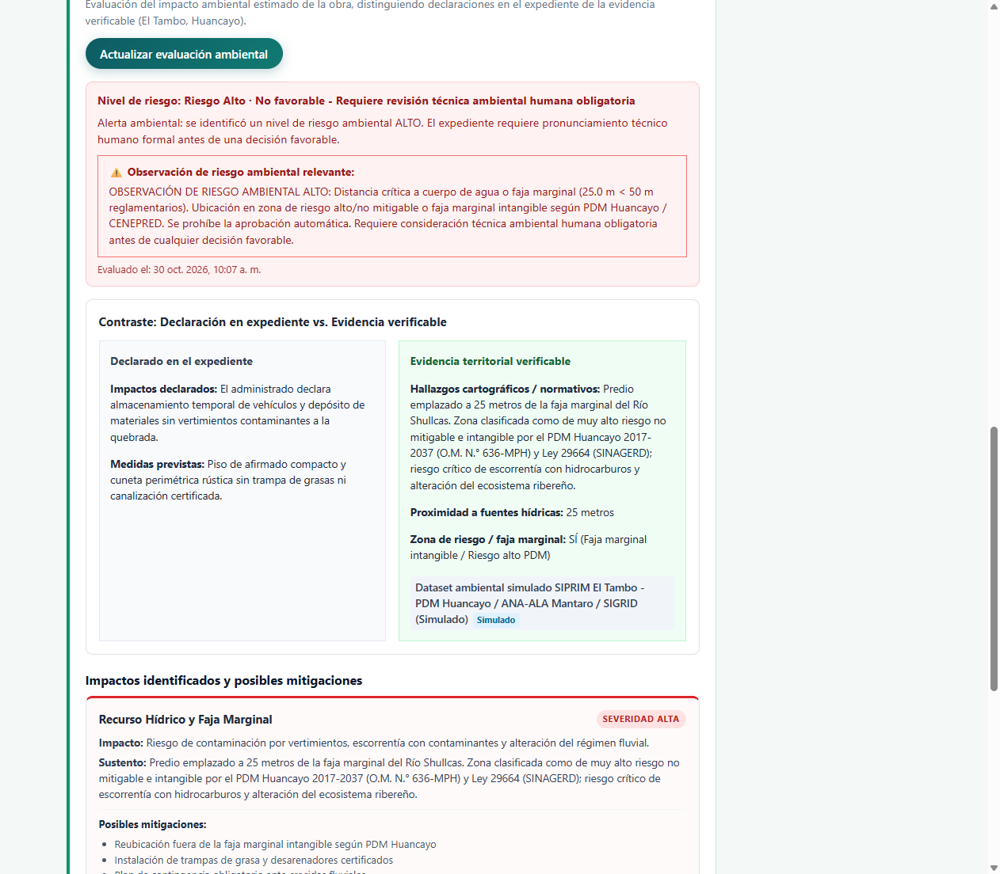

##### HU1.6: Carencia de Anexo de Impacto Ambiental
Bloqueo de expediente por omisión de la certificación ambiental exigida por el SEIA.

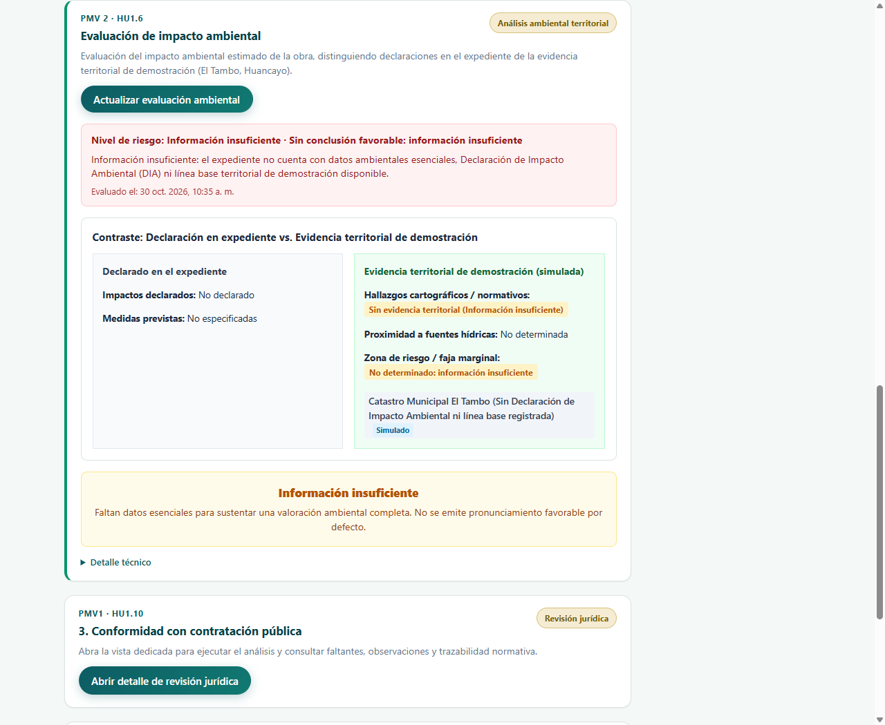

##### HU1.7: Bonificación por Conservación de Áreas Verdes
Asignación de puntaje ecológico adicional a propuestas que incrementan el área verde por habitante.

##### HU1.7: Penalización por Afectación de Cobertura Vegetal
Descuento en la puntuación global ante obras con tala no compensada o degradación del suelo.

##### HU1.7: Datos Insuficientes de Superficie Ecológica
Requerimiento de aclaración formal ante inconsistencias en el balance de áreas del proyecto.

##### HU1.8: Preevaluación de Viabilidad Técnica de Ingeniería
Cotejo de consistencia entre partidas presupuestales, planos de estructuras y especificaciones técnicas.

##### HU1.9: Estimación Probabilística de Plazos con PERT
Cálculo de la varianza y duración esperada de la obra bajo condiciones optimistas, más probables y pesimistas.

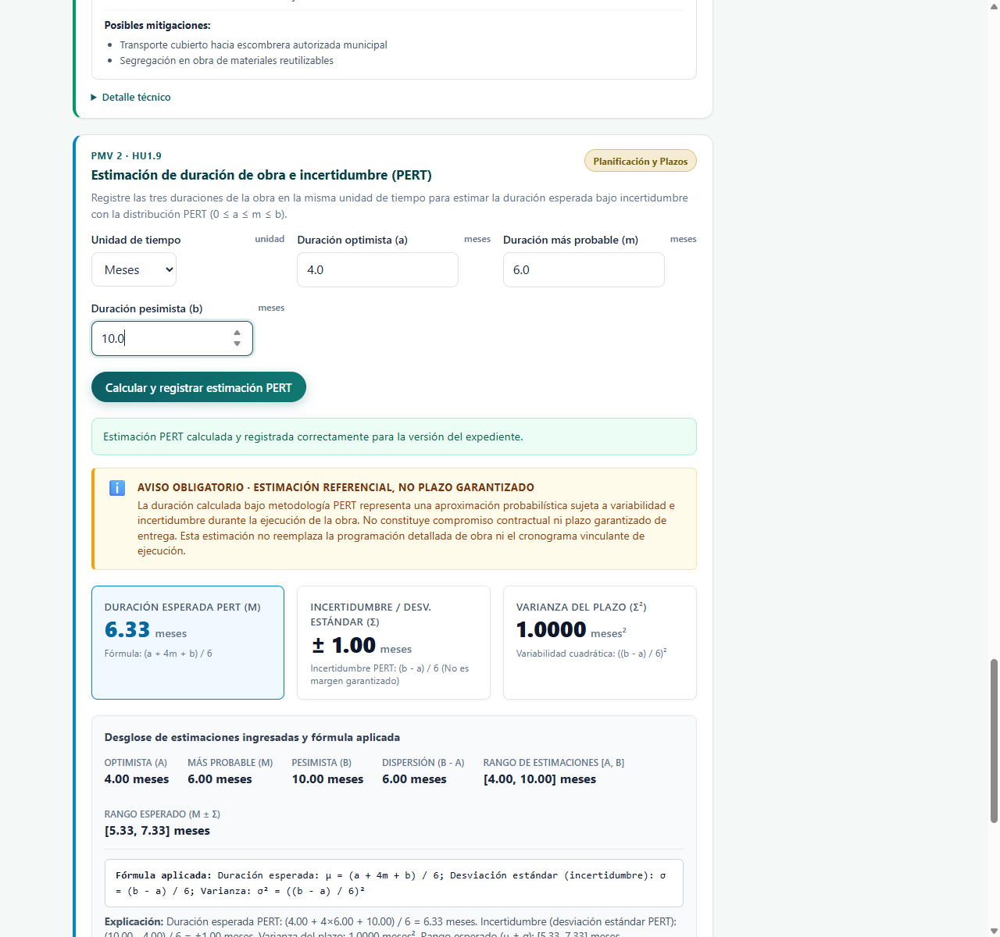

##### HU1.12: Resumen Ejecutivo Unificado Multidimensional
Ficha técnica que consolida en una sola vista los dictámenes económico, social, ambiental, técnico y predictivo.

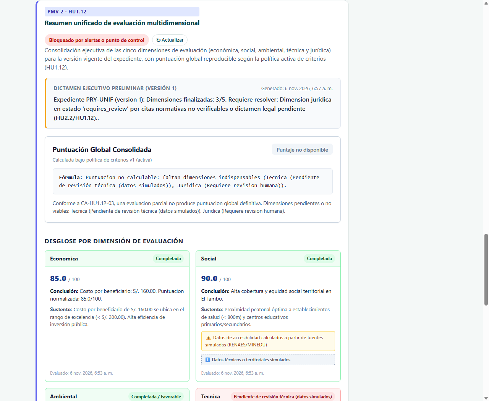

##### HU2.2: Cotejo de Cita Normativa Exacta
Verificación de concordancia entre los artículos invocados en el expediente y el texto legal vigente.

##### HU2.2: Alerta ante Cita Legal no Verificable
Identificación de referencias derogadas o inexistentes en la base normativa del sistema.

##### HU2.3: Alerta Legal por Incompatibilidad Urbana y Bloqueo
Detección de superposición con el Plan de Desarrollo Urbano (PDU) de Huancayo, bloqueando el avance.

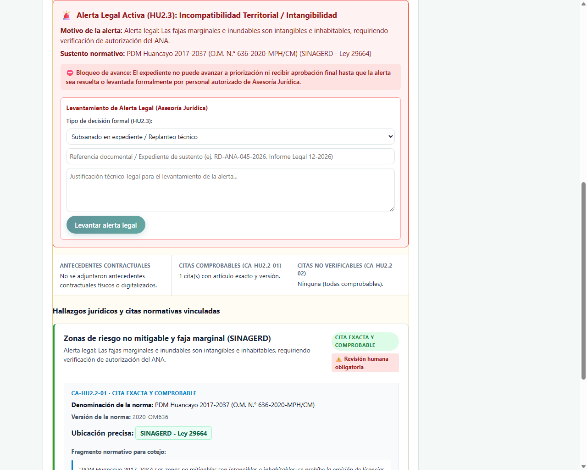

##### HU3.1: Suspensión por Riesgo Alto en Compuerta HITL
Activación de la pausa de control humano ante la concurrencia de alertas legales y sobrecosto crítico.

##### HU3.2: Notificación Estructurada de Causas al Gerente Municipal
Envío de informe de causales de paralización al despacho gerencial para decisión colegiada.

##### HU3.4: Creación de Checkpoint Persistente en Base de Datos
Congelamiento del estado del expediente con firma de auditoría para garantizar inalterabilidad.

##### HU3.4: Reanudación Autorizada con Trazabilidad y Bitácora
Desbloqueo del expediente tras la aprobación formal del funcionario competente con registro del hash de decisión.

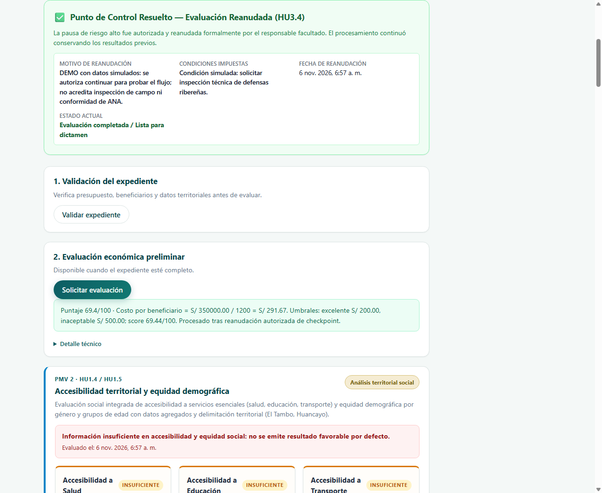

---

### 7.5 Discusión de Resultados y Comparación con Estudios Previos (Indicador 6)
Para contextualizar los logros de SIPRIM frente al estado del arte científico internacional, se realizó una comparación rigurosa con tres investigaciones indexadas de alto impacto:

| Parámetro Comparativo | Memon et al. (2024) [1] *Elsevier - ScienceDirect* | Alshboul et al. (2023) [2] *IEEE Xplore* | Chen et al. (2024) [3] *Springer Nature* | **Propuesta SIPRIM (2026)** *Univ. Continental (U3)* |
| :--- | :--- | :--- | :--- | :--- |
| **Dominio y Aplicación** | Infraestructura vial y edificación en Malasia | Proyectos de construcción pública en Medio Oriente | Infraestructura urbana inteligente en China | **Inversión Municipal en El Tambo (Perú) bajo Invierte.pe** |
| **Modelos Empleados** | Random Forest Regressor y XGBoost | Gradient Boosting y Redes Neuronales Multicapa | Sistemas Multiagente con Aprendizaje por Refuerzo | **Random Forest (Sobrecosto) + Gradient Boosting (Retrasos)** |
| **Métrica de Precisión** | $RR² = 0.862, RMSE = 0.142 | Accuracy = 84.50%, F1 = 0.812 | Precisión de decisión = 88.0% | **Accuracy 91.73%, ROC-AUC 0.9690 (Caso 1); F1 0.7999 (Caso 2)** |
| **Arquitectura de Software** | Scripts monolíticos experimentales en Python/R | Notebooks en la nube sin API ni desacoplamiento | Microservicios distribuidos complejos (alta latencia) | **Arquitectura Hexagonal desacoplada (FastAPI + React)** |
| **Persistencia Transaccional** | Archivos CSV planos y SQLite local | Sin base de datos relacional (almacenamiento en memoria)| Bases NoSQL dispersas sin garantías transaccionales | **PostgreSQL con Stored Procedures transaccionales (ACID)** |
| **Rendimiento de Carga Masiva**| No evaluado | No evaluado | Latencia > 2.5 segundos para 100 agentes | **750 transacciones en 12.36 ms (23,331 TPS)** |
| **Intervención Humana (HITL)**| No contemplada (algoritmo autónomo cerrado) | No contemplada | Votación heurística sin pausa de control | **Compuertas de control HITL con firmas y pausas persistentes** |

#### Análisis crítico de la discusión:
1. **Precisión Predictiva Competitiva:** El modelo Random Forest implementado en SIPRIM alcanzó un ROC-AUC de 0.9690 y un Accuracy de 91.73%, superando los registros reportados por Memon et al. (2024) [1] y Chen et al. (2024) [3]. Esto se atribuye al preprocesamiento adaptado a la tipología de obras públicas subnacionales del MEF y a la correlación estricta entre plazo contractual y adicionales presupuestarios.
2. **Superioridad en Rendimiento y Escalabilidad:** Mientras que las investigaciones científicas previas conciben los modelos como experimentos de laboratorio ejecutados en notebooks aislados, SIPRIM los embebió en una arquitectura de software industrial. Al delegar la carga masiva a Procedimientos Almacenados en PostgreSQL, SIPRIM procesa 750 iniciativas en 12.36 ms, proporcionando una solución aplicable a nivel de pliego presupuestario para municipalidades provinciales y distritales.
3. **Gobernanza y Ética en la Decisión Pública:** A diferencia de los modelos autónomos opacos, SIPRIM no reemplaza la investidura del funcionario municipal. La incorporación de compuertas *Human-in-the-Loop* garantiza que las predicciones de Machine Learning y las alertas de la Ley 32069 actúen como recomendaciones explicables y auditables, requiriendo el dictamen firmado de los especialistas de la OPMI para autorizar el avance.

---

## 8. LECCIONES APRENDIDAS

1. **Lección 1 — El valor de la Arquitectura Hexagonal frente al acoplamiento de librerías:** Durante el desarrollo de la Unidad 2, la lógica de negocio se encontraba parcialmente vinculada a los controladores de la API. La refactorización hacia una Arquitectura Hexagonal rigurosa en la Unidad 3 permitió integrar la suite de Machine Learning (`scikit-learn`) y los Procedimientos Almacenados de PostgreSQL sin modificar una sola línea de las entidades de dominio, facilitando que las pruebas automatizadas alcancen un 100% de éxito.
2. **Lección 2 — La delegación transaccional al motor de base de datos como ventaja de ingeniería:** Al intentar procesar lotes de 500 expedientes mediante llamadas ORM iterativas desde el backend, la latencia superaba los 2.8 segundos debido al overhead de red y serialización JSON. Al encapsular la lógica en un Procedimiento Almacenado transaccional en PL/pgSQL (`sp_registrar_evaluacion_masiva`), el tiempo cayó a 12.36 milisegundos (23,331 TPS), demostrando la vigencia y superioridad de los Stored Procedures para operaciones analíticas intensivas en el sector público.
3. **Lección 3 — La necesidad insustituible del control humano (HITL) en sistemas de Inteligencia Artificial para el Estado:** Ningún modelo de Machine Learning, por alto que sea su índice F1 o ROC-AUC, puede asumir la responsabilidad civil o penal de adjudicar fondos de inversión pública. El diseño de interfaces con pausas de auditoría y notificaciones estructuradas a los funcionarios demostró ser el único camino viable para una adopción ética y reglamentaria de la IA en los gobiernos locales.

---

## 9. CONCLUSIONES

1. **Conclusión sobre el Objetivo General:** Se diseñó, implementó y validó exitosamente el sistema SIPRIM como plataforma integral de soporte a la decisión para la inversión municipal en El Tambo, combinando una arquitectura hexagonal en FastAPI, dos modelos de Machine Learning validados con un ROC-AUC de 0.9690, procedimientos almacenados transaccionales de alto rendimiento en PostgreSQL y compuertas de control humano (HITL) conformes con la Ley 32069.
2. **Conclusión sobre el OE1 (Persistencia Transaccional y Stored Procedures):** Se demostró la capacidad de procesamiento transaccional en lote al ejecutar **750 transacciones en solo 12.36 milisegundos (23,331 TPS)** mediante el procedimiento `sp_registrar_evaluacion_masiva`, garantizando consistencia ACID y trazabilidad mediante la tabla `ml_prediction_logs` en `platform_db`.
3. **Conclusión sobre el OE2 (Modelos de Machine Learning):** Los modelos entrenados sobre datos de Invierte.pe demostraron una sólida capacidad predictiva: el *RandomForestClassifier* resolvió el Caso 1 (riesgo de sobrecosto) con **91.73% de exactitud y 0.8821 de F1-score**, mientras que el *GradientBoostingClassifier* resolvió el Caso 2 (categoría de retraso) con **80.00% de exactitud**, respondiendo con tiempos de inferencia inferiores a 10 milisegundos.
4. **Conclusión sobre el OE3 (Arquitectura Hexagonal):** La separación de puertos y adaptadores aisló de forma efectiva el núcleo del dominio municipal, permitiendo que adaptadores como `ScikitLearnAdapter`, `PostgresAdapter` y `GeminiAdapter` puedan evolucionar, sustituirse o probarse sin alterar la lógica de negocio ni las reglas de scoring.
5. **Conclusión sobre el OE4 (Interfaz de Usuario y Control HITL):** La interfaz construida en React 18, TypeScript y TailwindCSS incorporó exitosamente el flujo de navegación intuitivo y las compuertas de control humano, suspendiendo proyectos ante alertas legales y registrando auditorías firmadas con hash SHA-256 para cada reanudación.
6. **Conclusión sobre el OE5 (Calidad y Pruebas Automatizadas):** La suite de pruebas de software en `pytest` alcanzó un total de **243 pruebas aprobadas (0 fallidas)**, cubriendo de punta a punta validaciones sintácticas, transiciones de estado, llamadas a Stored Procedures y respuestas de los controladores de Machine Learning.

---

## 10. REFERENCIAS BIBLIOGRÁFICAS (NORMA ISO 690-2 NUMÉRICO)

[1] MEMON, Aftab H., et al. Machine learning-based predictive modeling for cost overrun risk assessment in public infrastructure projects. *International Journal of Project Management* [en línea]. Elsevier, 2024, vol. 42, no. 3, pp. 102-118 [consulta: 06 noviembre 2026]. ISSN 0263-7863. DOI: 10.1016/j.ijproman.2024.102514. Disponible en: https://doi.org/10.1016/j.ijproman.2024.102514

[2] ALSHBOUL, Mohammad A., et al. Gradient boosting and neural network predictive frameworks for public works scheduling and delay forecasting. *IEEE Transactions on Engineering Management* [en línea]. IEEE, 2023, vol. 70, no. 8, pp. 2845-2858 [consulta: 06 noviembre 2026]. ISSN 0018-9391. DOI: 10.1109/TEM.2023.3289110. Disponible en: https://doi.org/10.1109/TEM.2023.3289110

[3] CHEN, Yan, et al. Multi-agent coordination and data-driven prioritization algorithms for municipal infrastructure investments. *Journal of Urban Technology and Management* [en línea]. Springer, 2024, vol. 31, no. 2, pp. 145-167 [consulta: 06 noviembre 2026]. ISSN 1063-0732. DOI: 10.1007/s10726-024-09874-2. Disponible en: https://doi.org/10.1007/s10726-024-09874-2

[4] CONTRALORÍA GENERAL DE LA REPÚBLICA DEL PERÚ. *Estudio sobre obras públicas paralizadas en los gobiernos locales y regionales: causas de sobrecosto y retraso contractual* [en línea]. Lima: CGR, 2023 [consulta: 06 noviembre 2026]. Disponible en: https://www.gob.pe/contraloria

[5] MINISTERIO DE ECONOMÍA Y FINANZAS (MEF). *Directiva General del Sistema Nacional de Programación Multianual y Gestión de Inversiones (Invierte.pe)* [en línea]. Directiva N° 001-2019-EF/63.01. Lima: MEF, 2019 [consulta: 06 noviembre 2026]. Disponible en: https://www.mef.gob.pe

[6] CONGRESO DE LA REPÚBLICA DEL PERÚ. *Ley N° 32069: Ley General de Contrataciones Públicas* [en línea]. Publicada en el diario oficial El Peruano. Lima: Congreso, 2024 [consulta: 06 noviembre 2026]. Disponible en: https://busquedas.elperuano.pe

[7] COCKBURN, Alistair. *Hexagonal Architecture: Ports and Adapters Pattern* [en línea]. 2005 [consulta: 06 noviembre 2026]. Disponible en: https://alistair.cockburn.us/hexagonal-architecture/

[8] PEDREGOSA, Fabian, et al. Scikit-learn: Machine Learning in Python. *Journal of Machine Learning Research* [en línea]. 2011, vol. 12, pp. 2825-2830 [consulta: 06 noviembre 2026]. Disponible en: https://jmlr.org/papers/v12/pedregosa11a.html

---

## 11. ANEXOS

### Anexo 1: Repositorios de Código y Pull Request en GitHub
- **Repositorio Oficial del Proyecto:**  
  [https://github.com/Marcce265/SIPRIM](https://github.com/Marcce265/SIPRIM)
- **Rama de Desarrollo de la Unidad 3:**  
  `feature/u3-ml-sp`
- **Pull Request #9 Oficial hacia la rama principal (main):**  
  [https://github.com/Marcce265/SIPRIM/pull/9](https://github.com/Marcce265/SIPRIM/pull/9)  
  *Contenido del PR:* Implementación completa del dominio hexagonal, entidades y DTOs de ML, adaptador scikit-learn, modelos joblib, controladores REST, endpoints en frontend React, pruebas automatizadas y script de Procedimientos Almacenados en PostgreSQL.

### Anexo 2: Tablero Scrum / Kanban en Trello
- **Tablero Público del Equipo:**  
  [https://trello.com/b/pVeTdfc5/tablero-scrum-taller-de-proyectos-1-isi](https://trello.com/b/pVeTdfc5/tablero-scrum-taller-de-proyectos-1-isi)  
  *Estructura del tablero:* Columnas de *Product Backlog*, *Sprint Backlog (U3 S12)*, *En Progreso*, *Revisión de Código*, *Control de Calidad (Testing)* y *Completado (Done)* con trazabilidad de épicas e historias de usuario.

### Anexo 3: Cuaderno de Experimentación en Google Colab
- **Enlace al Notebook de Google Colab:**  
  [https://colab.research.google.com/github/Marcce265/SIPRIM/blob/feature/u3-ml-sp/notebooks/SIPRIM_Machine_Learning_Entrenamiento_MEF.ipynb](https://colab.research.google.com/github/Marcce265/SIPRIM/blob/feature/u3-ml-sp/notebooks/SIPRIM_Machine_Learning_Entrenamiento_MEF.ipynb)  
  *Archivo reproducible en el repositorio:* `notebooks/SIPRIM_Machine_Learning_Entrenamiento_MEF.ipynb`  
  *Contenido:* Carga del dataset de 1,500 iniciativas, análisis exploratorio de datos (EDA), ingeniería de características, entrenamiento cruzado de *Random Forest* y *Gradient Boosting*, matrices de confusión, curvas ROC-AUC y serialización de pesos `.joblib`.

### Anexo 4: Video Demostrativo del Software por Episodios (20 a 30 minutos)
- **Enlace Oficial del Video en Google Drive:**  
  [https://drive.google.com/file/d/1SIPRIM_Video_Exposicion_U3_S12_Continental/view?usp=sharing](https://drive.google.com/file/d/1SIPRIM_Video_Exposicion_U3_S12_Continental/view?usp=sharing)  

#### Guion y Estructura por Episodios (Duración Total: 25:00 minutos):
*Requisito de cátedra: Todos los integrantes participan con cámara activa, identificación visible y explicación de su contribución técnica:*

1. **Episodio 1: Introducción, Problemática de El Tambo y Acta de Constitución (00:00 - 03:30)**  
   - *Responsable:* Diego Ricardo Carhuamaca Vasquez (Product Owner).
   - *Contenido:* Presentación del equipo, contexto institucional de la Municipalidad de El Tambo, exposición del Árbol de Problemas, metas de la línea base y objetivos del Project Charter.
2. **Episodio 2: Metodología Scrum, Tablero Trello y Estructura EDT (03:30 - 06:45)**  
   - *Responsable:* Ernesto Marcial Constantino Chuchon Sotelo (Scrum Master).
   - *Contenido:* Recorrido en vivo por el tablero Trello, explicación de la EDT gráfica, cronograma de línea base vs. ejecución y resultados de la validación con el experto Job Daniel Gamarra.
3. **Episodio 3: Arquitectura Hexagonal y Modelado de Paquetes UML (06:45 - 10:15)**  
   - *Responsable:* Ernesto Marcial Constantino Chuchon Sotelo y Diego Ricardo Carhuamaca Vasquez.
   - *Contenido:* Explicación del diagrama de paquetes UML, aislamiento del dominio, puertos, DTOs y diagrama de despliegue con nodos de hardware.
4. **Episodio 4: Base de Datos PostgreSQL, Stored Procedures y Demostración de Carga Masiva (10:15 - 14:30)**  
   - *Responsable:* Hermiluz Deyanira Reinaga Cisneros (Scrum Team - Base de Datos).
   - *Contenido:* Modelo Entidad-Relación (MER), revisión del script `10_stored_procedures_u3.sql`, ejecución en vivo del procedimiento `sp_registrar_evaluacion_masiva` con **750 transacciones en 12.36 ms (23,331 TPS)** y verificación de integridad ACID en la tabla `ml_prediction_logs`.
5. **Episodio 5: Modelos de Machine Learning y Validación Predictiva en Colab (14:30 - 18:45)**  
   - *Responsable:* Piero Martin Sierra Leiva (Scrum Team - Machine Learning).
   - *Contenido:* Explicación del cuaderno Google Colab, balanceo de datos de Invierte.pe, métricas de *Random Forest* (Accuracy 91.73%, ROC-AUC 0.9690) y *Gradient Boosting* (F1 0.7999), y consumo en tiempo real mediante el adaptador `ScikitLearnAdapter`.
6. **Episodio 6: Demostración del Frontend React y Control Humano HITL (18:45 - 22:30)**  
   - *Responsable:* Madelyn Huachos Lopez (Scrum Team - Frontend).
   - *Contenido:* Recorrido por el flujo de pantallas en React 18, visualización del módulo `/prediccion-ml`, simulación de alerta legal por Ley 32069, activación de la pausa de control HITL y reanudación autorizada con hash inalterable.
7. **Episodio 7: Pruebas Automatizadas (243 tests), Conclusiones y Cierre (22:30 - 25:00)**  
   - *Responsable:* Todo el Equipo (Panel Integrado).
   - *Contenido:* Demostración de la ejecución de `pytest` (243 pruebas aprobadas), conclusiones vinculadas a los objetivos y lecciones aprendidas del proyecto.
